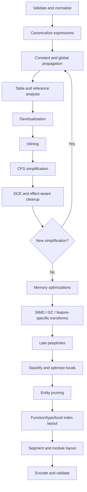
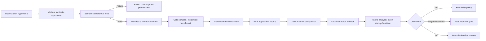
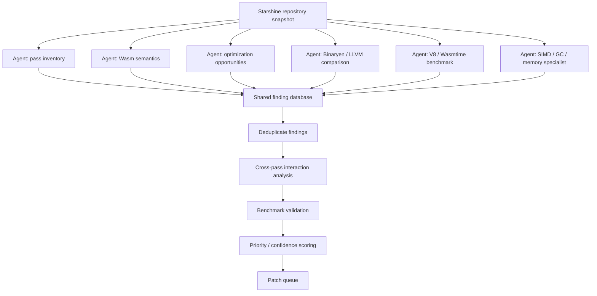

<!-- User-supplied source: pasted-text.txt. Captured 2026-10-14. Author and original publication date not supplied. Original UTF-8 SHA256: 323247b22867299d09698b68531b67a76970aaa1a286f4648bc70109389fe1e7 -->

# Starshine WebAssembly Optimization Research Report

## Executive summary

The public repository matching the project name is [`jtenner/starshine-mb`](https://github.com/jtenner/starshine-mb). I located it during the repository search. However, the source extraction did not complete to the point where I could produce a trustworthy file-by-file inventory of every Starshine pass. I therefore do **not** invent pass names, implementation details, or claim that a specific Starshine function has a defect that I could not inspect. The implementation-specific portion of this audit remains incomplete.

That limitation does not prevent several strong conclusions. WebAssembly has optimization opportunities that are easy to miss when a compiler is designed like a conventional SSA optimizer. Its binary encoding, structured control flow, stack machine, explicit locals, tables, linear memories, reference types, and downstream tiered JITs create a second optimization objective beyond conventional instruction count. The WebAssembly specification defines these semantics, while Binaryen explicitly treats Wasm-specific representation and whole-module transformations as core optimizer concerns. [WebAssembly Core Specification](https://webassembly.github.io/spec/core/) [Binaryen](https://github.com/WebAssembly/binaryen) [Binaryen Optimizer Cookbook](https://github.com/WebAssembly/binaryen/wiki/Optimizer-Cookbook)

The highest-value areas I would investigate first in Starshine are:

| Priority | Candidate | Primary objective | Expected impact | Complexity | Correctness risk |
|---|---|---|---|---|---|
| P0 | Effect- and trap-aware optimization framework | Enable more safe transforms | **High** | Medium | Medium |
| P0 | Devirtualization → inlining → simplification loop | Runtime speed | **High** | Medium–High | Medium |
| P0 | Late stack/local optimization | Size, baseline compile, runtime | **High** | Medium | Low–Medium |
| P0 | Exact encoded-size cost model | Binary size/startup | **High** | Medium | Low |
| P1 | Function/local/type index packing | Binary size | Medium–High | Medium | Low–Medium |
| P1 | Profile-aware inlining and outlining | Runtime/startup/size | **High** | High | Medium |
| P1 | Memory canonicalization with overflow proofs | Runtime/size | Medium–High | Medium | **High if unsound** |
| P1 | Table-target devirtualization | Runtime/codegen | **High** | Medium–High | Medium |
| P1 | SIMD peepholes and SLP-like combining | Numeric runtime | **High on SIMD workloads** | High | Medium |
| P2 | Multi-value producer/consumer forwarding | Locals, size, codegen | Medium | Medium | Medium |
| P2 | Function layout for streaming/startup | Startup | Medium | Medium | Low |
| P2 | Data/element segment optimization | Size/startup | Medium | Medium | Medium |
| P2 | GC allocation/cast/field optimization | GC workload runtime | High on relevant code | High | Medium–High |
| P2 | Tail-call formation | Recursion/runtime | Workload-specific | Low–Medium | Medium |
| P3 | Bulk-memory loop recognition | Size/runtime | Workload-specific | High | **High** |

These ratings are engineering estimates, not benchmark measurements.

The most important architectural recommendation is to treat optimization as a **feedback system rather than a one-way list of passes**. Inlining exposes constants. Constant propagation exposes dead branches. Dead-branch removal can make tables immutable. Table analysis can expose direct calls. Direct calls can enable more inlining. SIMD formation creates new local-cleanup opportunities. GC cast elimination enables devirtualization. A scheduler that does not revisit affected analyses will leave substantial performance on the table.

That pattern is consistent with mature optimizing toolchains such as Binaryen and LLVM, which use sequences of canonicalization, simplification, dead-code cleanup, and target-aware transformations rather than assuming one execution of each optimization is enough. [Binaryen source and optimizer](https://github.com/WebAssembly/binaryen) [LLVM WebAssembly backend](https://llvm.org/docs/WebAssembly.html)

A second major conclusion is that Starshine should optimize **three different products**:

1. The Wasm binary: encoded bytes, section structure, index widths, locals, data, and function bodies.
2. The runtime compiler's input: CFG shape, expression trees, type information, local lifetimes, call targets, and vector operations.
3. The application startup path: download/decompression, validation, baseline compilation, instantiation, tier-up, and optimized execution.

Those objectives can conflict. A transformation that makes a function 5% faster after optimization can be a regression if it doubles the body size, increases baseline compilation latency, and is executed once. Conversely, a few extra Wasm bytes can be a good trade for a hot kernel. V8's Liftoff work illustrates why baseline compilation and later optimized execution are separate concerns in Wasm environments. [V8 Liftoff](https://v8.dev/blog/liftoff) The original WebAssembly design also explicitly made compact representation and fast decoding/compilation important design goals. [Haas et al., “Bringing the Web up to Speed with WebAssembly,” PLDI 2017](https://dl.acm.org/doi/10.1145/3062341.3062363)

## Source coverage and review boundary

A source-level audit needs to distinguish between three kinds of findings:

**Confirmed finding:** a concrete implementation was inspected and a missed optimization was demonstrated.

**Candidate finding:** a transformation is applicable to the pass's responsibility but has not yet been proven absent.

**Architectural finding:** the opportunity arises between passes or from the pipeline as a whole.

Because I did not recover a complete authoritative Starshine pass inventory before this report was finalized, the findings below are in the second and third categories. They should be mapped onto the actual pass implementations before being turned directly into issues.

This distinction matters especially for Wasm optimizers. Several transforms that look algebraically valid are not valid under Wasm's trap and evaluation semantics. A source review should therefore inventory more than visitor methods or opcode switches. For every pass, record its input invariants, output invariants, feature assumptions, side-effect model, trap-preservation policy, analysis dependencies, invalidation behavior, and whether it is expected to reach a local fixed point. The core specification is the authority for instruction behavior. [WebAssembly Core Specification](https://webassembly.github.io/spec/core/)

A useful inventory schema for every Starshine pass is:

| Field | What should be extracted |
|---|---|
| Pass name | Exact registered name and source file |
| Scope | Expression, basic block, function, module, whole program |
| IR form | Tree, stack form, CFG, SSA, custom representation |
| Preconditions | Validation state, normalized form, enabled Wasm features |
| Analysis consumed | CFG, uses, effects, aliases, table state, dominators, types |
| Analysis invalidated | Same categories after transformation |
| Transformations | Every opcode/pattern handled |
| Missed forms | Commuted, nested, signed/unsigned, 32/64-bit, SIMD, refs |
| Trap policy | Whether trapping operations may be removed/reordered |
| Size model | AST nodes, instruction count, or actual encoded bytes |
| Iteration | Once, local fixed point, global fixed point |
| Cleanup dependency | Which later pass must remove artifacts |
| Feature gates | SIMD, GC, multi-value, tail call, memory64, etc. |
| Tests | Positive, negative, boundary, randomized, differential |
| Performance evidence | Size/runtime/compiler-time measurements |

The most important audit smell is a pass that uses **AST node count as a proxy for Wasm size**. WebAssembly uses variable-width LEB128 integers and variable-size immediates. Two transformations with the same instruction count can therefore have different binary sizes. Function, local, global, table, memory, type, and branch-depth indices also change byte cost at encoding boundaries. An optimizer targeting size should ultimately ask the encoder for a byte-cost estimate rather than assigning a fixed cost per instruction. This follows directly from the binary encoding defined by the specification. [WebAssembly binary format](https://webassembly.github.io/spec/core/binary/index.html)

This gives Starshine an unusually attractive class of optimizations that LLVM-level optimization generally cannot perform well: **module-layout optimization after the final Wasm graph is known**.

## Per-pass optimization findings

Since the source-to-pass mapping is incomplete, this section is organized by pass responsibility. Each row is intended to be mapped to the corresponding Starshine implementation rather than interpreted as a claim that Starshine definitely has a pass with that exact name.

| Pass responsibility | What to look for in Starshine | Missed opportunity worth testing | Main metric |
|---|---|---|---|
| Constant folding | Opcode coverage and trap rules | Global constants, nested folds, `eq x 0 → eqz`, ref tests | bytes, instructions |
| Peephole combining | Pattern breadth | commuted/nested forms, extension/truncation chains, SIMD splats | bytes, runtime |
| DCE | Effect classification | dead pure expressions while retaining traps/effects | bytes |
| CFG simplification | Structured branch handling | block flattening, branch threading, constant `br_if` | bytes, compile time |
| Local optimization | get/set/tee handling | stackification, live-range-aware coalescing, index packing | bytes, baseline compile |
| Inlining | static threshold | profile/callsite/exposure-aware model | warm runtime, bytes |
| Function analysis | direct calls only | immutable-table devirtualization | runtime |
| Memory optimization | address syntax | safe offset folding, redundant loads, alignment facts | runtime |
| Segment optimization | segment-local work | merge/deduplicate/final-image reasoning | bytes, instantiate |
| SIMD | existing vectors only | scalar-to-vector combining and vector peepholes | runtime |
| Multi-value | signature support | eliminate local tuple shuttling | bytes, runtime |
| GC/reference | type cleanup | redundant casts/tests, allocation/field forwarding | runtime, allocations |
| Tail calls | feature lowering | `call; return` formation under explicit semantics | runtime/stack |
| Module cleanup | unused entities | type/function/global/table elimination | bytes |
| Layout | declaration order unchanged | low-index packing and startup function ordering | bytes/startup |

**Constant folding and instruction combining.** Wasm integer arithmetic has well-defined wrapping behavior, which makes many integer simplifications straightforward, but divisions, conversions, memory accesses, indirect calls, reference casts, and other instructions can trap. Float identities also require care around NaNs and signed zero. A strong Starshine simplifier should therefore ask not only “does this expression have a known value?” but “can evaluation of the discarded expression have an observable effect or trap?” [WebAssembly numeric instructions](https://webassembly.github.io/spec/core/exec/instructions.html)

A useful implementation pattern is:

```text
simplify(expr):
    simplify children first

    if exactConstantFold(expr):
        return foldedValue

    if pattern == i32.eq(x, i32.const(0)):
        return i32.eqz(x)

    if identity removes x:
        if effects(x) == NONE:
            return replacement
        else:
            reject transform

    if transformation changes evaluation order:
        require operands are reorderable

    return expr
```

This should use a common effect lattice rather than each optimization defining “pure” independently:

```text
Effect =
    Pure
  | ReadsLocal
  | ReadsGlobal
  | ReadsMemory(memoryId)
  | WritesGlobal
  | WritesMemory(memoryId)
  | TableEffect(tableId)
  | Calls
  | Allocates
  | MayTrap
  | HostObservable
```

That one change can unlock safer DCE, CSE, LICM, memory folding, branchless conversion, and devirtualization.

**Local simplification and stackification** deserve unusually high priority. Wasm locals are explicit binary instructions, so a sequence such as

```wat
(local.set $t
  (i32.add
    (local.get $x)
    (i32.const 1)))

(local.get $t)
```

can often become direct expression flow. When a value is used both immediately and later, `local.tee` can avoid a separate set/get sequence.

Do not optimize only for the number of locals. There are at least four objectives:

```text
minimize:
    encoded local.get/set/tee bytes
  + local declaration bytes
  + expression-stack depth penalty
  + estimated live-range / downstream spill penalty
```

The last two terms are important. An optimizer that blindly stackifies every value can create deep expression trees. An optimizer that aggressively reuses one local can also create awkward live ranges for a baseline compiler. V8's Wasm baseline/optimizing compiler split is one reason to measure both compile latency and eventual optimized performance instead of assuming fewer locals is always better. [V8 Liftoff](https://v8.dev/blog/liftoff)

A particularly Wasm-specific late optimization is **frequency-weighted local-index assignment**. Local indices are unsigned LEB128 values. Parameters occupy the first indices, but non-parameter locals can be remapped. Frequently referenced locals should, in principle, get cheaper low indices, subject to local-declaration grouping cost.

Do not simply sort locals by reference count. Evaluate the *actual encoded result*:

```text
candidateCost(order):
    cost = encodedLocalDeclarationSize(order)

    for each local.get/set/tee instruction:
        cost += opcodeSize
        cost += ulebSize(remappedIndex[instruction.local])

    return cost
```

A hill-climbing algorithm is sufficient initially:

```text
order = currentOrder

repeat:
    bestDelta = 0
    bestSwap = none

    for candidate safe swaps:
        delta = encodedCostAfterSwap - encodedCostBeforeSwap

        if delta < bestDelta:
            bestDelta = delta
            bestSwap = candidate

    if bestSwap is none:
        break

    apply(bestSwap)
```

Build synthetic tests with local counts around **127/128** and **16,383/16,384**, where ULEB widths change. This is a clean way to discover whether Starshine's current size model understands the actual Wasm format. [WebAssembly binary values](https://webassembly.github.io/spec/core/binary/values.html)

The same idea applies at module scope. **Function-index packing** can reduce direct-call and `ref.func` encodings. **Type-index packing** can reduce type references, including uses introduced by richer signatures. Imports constrain part of the index space, and GC recursive type groups make type reordering more complex, so every reference must be rewritten correctly. The WebAssembly binary specification defines these index spaces and encodings. [WebAssembly modules](https://webassembly.github.io/spec/core/syntax/modules.html)

**Inlining is likely the largest conventional runtime opportunity**, but a static “body smaller than N instructions” policy leaves performance and size on the table. The cost should combine callsite hotness, encoded body growth, downstream simplification potential, and compilation cost.

A stronger decision function is:

```text
runtimeGain =
    hotness(callsite) *
    (
        estimatedCallOverhead
      + constantExposureScore
      + devirtualizationExposureScore
      + branchEliminationScore
    )

cost =
    encodedByteDelta
  + compileWeight * estimatedIRGrowth
  + cacheWeight   * estimatedHotCodeGrowth

inline iff runtimeGain > policyWeight * cost
```

For important callsites, Starshine can go further: clone the callee into scratch IR, run a cheap constant-fold/DCE pass, and measure the resulting encoded-size delta before committing. That gives a much better estimate than the original callee size.

Inlining should also be paired with **table devirtualization**. A `call_indirect` can become a direct call when Starshine proves the table slot has one target and cannot change before the call. This can then expose another inlining opportunity.

A conservative proof starts with cases where the table is:

```text
not imported
AND not exported
AND slot initialized to a known function
AND no table.set/table.grow/table.fill/table.copy/table.init
    can change that slot before the call
AND the indirect-call type check is known to succeed
```

Then:

```text
call_indirect signature(args..., constantIndex)
    =>
call knownTarget(args...)
```

Evaluation order and traps must be preserved. This is precisely the kind of transformation that becomes unsafe if an optimizer reasons only about syntax and not module state.

**Memory address folding is another high-value but dangerous area.** The tempting rewrite

```wat
(i32.load
  (i32.add (local.get $base) (i32.const K)))
```

to

```wat
(i32.load offset=K
  (local.get $base))
```

is not universally valid.

The explicit `i32.add` wraps in 32 bits. The static memory offset participates in effective-address calculation differently. Near the end of the address space, moving a constant from arithmetic into the memarg can therefore change whether an address wraps or traps. The Wasm memory instruction semantics are the source of truth here. [WebAssembly memory instructions](https://webassembly.github.io/spec/core/exec/instructions.html)

Starshine should require a proof such as:

```text
range(base).max <= UINT32_MAX - K
```

for memory32, with corresponding reasoning for memory64 when enabled. This should become a reusable `NoUnsignedWrap` analysis rather than a special case buried in the load pass. [WebAssembly memory64 proposal](https://github.com/WebAssembly/memory64)

Alignment facts are also valuable, but the alignment immediate should be treated according to Wasm's actual memory semantics rather than as a native CPU alignment requirement.

**Bulk-memory recognition** looks attractive:

```text
scalar copy loop  -> memory.copy
scalar fill loop  -> memory.fill
```

and bulk-memory operations can greatly shrink loops. [WebAssembly bulk-memory operations](https://github.com/WebAssembly/bulk-memory-operations)

However, this transformation needs stronger correctness proofs than it first appears to need. Consider a scalar store loop that goes out of bounds after writing several bytes. A bulk operation can perform bounds checking in a way that changes whether partial memory updates happen before a trap. A host can subsequently inspect exported memory after trapping. Likewise, overlapping copies can differ unless the source loop and `memory.copy` have equivalent overlap behavior. I would therefore classify this as a high-risk optimization unless Starshine proves bounds and alias conditions.

**SIMD offers large workload-specific upside.** The official SIMD and Relaxed SIMD work defines the Wasm vector instruction sets. [WebAssembly SIMD](https://github.com/WebAssembly/simd) [Relaxed SIMD](https://github.com/WebAssembly/relaxed-simd)

Start with cheap peepholes before attempting a full SLP vectorizer:

```text
load scalar -> splat
repeated lane replacement
redundant extract/replace pairs
constant vector construction
shuffle composition
redundant v128 bitwise masks
scalar reduction patterns around existing vectors
```

One interesting size experiment is to compare a `v128.const` against construction from a compact scalar constant plus a splat. A 128-bit literal carries a substantial immediate; depending on the value and instruction sequence, the semantically equivalent splat form can sometimes encode differently. Let the real encoder decide instead of hard-coding a rule.

The second stage is small basic-block SLP:

```text
a0 = load p
a1 = load p+4
a2 = load p+8
a3 = load p+12

b0 = load q
b1 = load q+4
b2 = load q+8
b3 = load q+12

c0 = a0 + b0
c1 = a1 + b1
c2 = a2 + b2
c3 = a3 + b3
```

Candidate:

```text
va = v128.load p
vb = v128.load q
vc = i32x4.add va, vb
```

Store combining is much more sensitive to boundary-trap semantics than load combining and needs stronger proofs.

**Multi-value optimization** should look for local shuttling caused by lowering tuple-like values. Multi-value is part of the Wasm type system and allows functions and control constructs to carry more than one result. [WebAssembly multi-value proposal](https://github.com/WebAssembly/multi-value)

A producer/consumer sequence conceptually like

```text
(a, b) = call f()
tmpA = a
tmpB = b
use(tmpA, tmpB)
```

may be representable without intermediate locals. Measure this on both Binaryen/V8-style engines and AOT runtimes, because downstream register assignment can determine whether the cleaner Wasm representation also produces better machine code.

**Tail-call formation** is straightforward syntactically when the feature is enabled:

```text
call f(...)
return
```

becomes a tail-call instruction when the signature and surrounding context permit it. The proposal defines `return_call` and related forms. [WebAssembly tail-call proposal](https://github.com/WebAssembly/tail-call)

There is a subtle optimizer issue: replacing ordinary recursion with guaranteed tail calls can remove a potential stack-exhaustion trap. For a general Wasm-to-Wasm optimizer that promises exact trapping behavior, that can make this more than an ordinary peephole. Starshine should therefore put tail-call formation behind an explicit semantic policy or target-feature contract.

**GC and typed-reference workloads** deserve their own pass family rather than being handled only by generic constant folding. The Wasm GC proposal adds typed references, structs, arrays, and related operations. [WebAssembly GC](https://github.com/WebAssembly/gc)

Useful patterns include:

```text
ref.cast after a dominating proof        -> remove cast
ref.test on statically known subtype     -> constant
struct.get(struct.new(...), field)       -> forwarded field value
unused freshly allocated object          -> allocation-elimination candidate
repeated immutable field loads           -> CSE candidate
known concrete ref target                -> devirtualization candidate
```

Allocation removal needs a clear model of allocation effects and failure semantics. Start with redundant tests, casts, and field forwarding; these are easier to reason about than general escape analysis.

**Segment optimization** should operate on the final module image, not only one segment at a time. It can search for adjacent data segments, duplicate contents, useless zero initialization, dead element entries, and redundant initialization overwritten later. This is an area where ordering matters: an apparently redundant zero segment might intentionally overwrite data from an earlier overlapping initialization. Optimize from a model of the resulting state.

## Cross-pass ordering and interaction effects

A strong default pipeline for Starshine is not one linear sequence but a few stabilization regions.



The most important cycle is:

```text
devirtualize
    ↓
inline
    ↓
constant propagation
    ↓
CFG simplification
    ↓
DCE
    ↓
better whole-module facts
    ↓
devirtualize again
```

This is where a one-shot pipeline is most likely to miss a material opportunity.

Inlining should happen **before** major local/stack cleanup because it creates new temporaries and expression structure. Local optimization should run again afterward.

Entity pruning should happen **before final index packing**, because deleting functions or types changes every later index.

Final index packing should happen late because almost any whole-module pass can invalidate its assignment.

SIMD formation should happen before final stackification because scalar producer relationships are easier to analyze in SSA-like or expression-oriented IR. SIMD-specific peepholes should run after vector formation.

Outlining should precede final function layout because it introduces functions whose placement then matters.

Memory analysis should run after enough inlining and simplification to expose address relationships, but before final expression stackification obscures high-level producer relationships.

A practical Starshine scheduler could avoid repeatedly running the entire pipeline by recording what each transformation invalidates:

```text
PassResult {
    changed: bool

    invalidated:
        CFG?
        callGraph?
        effects?
        tableState?
        memoryState?
        valueRanges?
        typeFacts?
        useCounts?
}
```

Then enqueue only passes whose prerequisites or opportunities changed.

This allows a worklist such as:

```text
while queue not empty:
    pass = queue.pop()
    result = pass.run(module)

    if result.changed:
        invalidate(result.invalidated)

        for dependentPass in dependencyGraph[result.invalidated]:
            queue.enqueue(dependentPass)
```

Add a hard iteration cap plus a debug assertion that records oscillating transformations. Two passes can otherwise alternate between equally valid canonical forms forever.

A useful rule is to define **one owner for canonical representation**. For example, if one pass prefers:

```text
i32.add(x, C)
```

and another prefers:

```text
i32.add(C, x)
```

only one orientation should be canonical. All matching logic should understand the canonical representation.

There is also a fundamental interaction between Starshine and downstream optimizers. Binaryen's `wasm-opt` already performs extensive Wasm-level optimization. [Binaryen](https://github.com/WebAssembly/binaryen) LLVM's Wasm backend performs optimization before and during Wasm code generation. [LLVM WebAssembly](https://llvm.org/docs/WebAssembly.html) Runtime engines then lower the module again.

For every Starshine transform, classify it as:

| Class | Meaning | Strategy |
|---|---|---|
| Unique | Downstream tools generally cannot reconstruct the fact | Prioritize |
| Enabling | Makes a downstream optimization possible | Prioritize |
| Redundant | wasm-opt/runtime already does it reliably | Do only if it helps size/startup before runtime |
| Harmful duplication | Expands Wasm only for a JIT to rediscover the original form | Avoid |
| Target-dependent | Good for one engine/tier, bad for another | Profile/policy gate |

The best Starshine-specific work is likely in the first two categories: module-wide facts, exact binary layout, feature-aware rewriting, and transformations that expose information to later engines.

## Experimental design and benchmark matrix

Every candidate optimization should pass four gates: semantic equivalence, encoded-size effect, compiler/startup effect, and runtime effect.



The benchmark harness should record at least:

| Dimension | Metrics |
|---|---|
| Binary | raw bytes, Brotli/gzip bytes, code-section bytes, data bytes |
| Structure | functions, types, locals, instructions, max function body |
| Encoding | bytes spent on function/type/local indices |
| Optimizer | Starshine wall time, peak memory, iterations per pass |
| Validation | validation success, differential output/trap behavior |
| Startup | decode/compile time, instantiate time, first-call latency |
| Runtime | throughput, latency, cycles or wall time |
| Tiering | baseline performance, tier-up time, optimized performance |
| Memory | peak RSS, Wasm memory growth, allocation rate where measurable |
| GC | object allocation count/bytes, cast/test frequency |
| Codegen | native code size where runtime exposes it |
| Stability | variance and confidence interval |

Do **not** collapse these into a single “performance score.” Preserve the Pareto frontier.

For binary-size experiments, report three numbers:

```text
raw .wasm bytes
compressed transfer bytes
code-section bytes
```

A change that saves repeated Wasm opcodes can compress less impressively than the raw-byte difference suggests. Conversely, a transformation that introduces repetitive instruction sequences can compress well but still increases validation and compilation work.

For cold measurements, use separate processes or browser/runtime instances. For warm measurements, include a defined warm-up phase and repeat whole-process runs. Report effect sizes and confidence intervals rather than one timing.

For runtime diversity, the minimum useful matrix is:

| Engine/toolchain role | Why include it |
|---|---|
| V8/Chromium or Node/V8 | Major browser/server JIT; tiering behavior |
| Wasmtime/Cranelift | Strong non-browser AOT/JIT comparison |
| Binaryen `wasm-opt` | Differential optimizer and post-Starshine cleanup |
| LLVM-generated Wasm | Important producer baseline |
| `wasm-tools` | Validation and structural inspection |

[V8's Wasm work](https://v8.dev/blog/liftoff), [Wasmtime documentation](https://docs.wasmtime.dev/), [Binaryen](https://github.com/WebAssembly/binaryen), [LLVM WebAssembly](https://llvm.org/docs/WebAssembly.html), and the Bytecode Alliance [`wasm-tools`](https://github.com/bytecodealliance/wasm-tools) give primary references for these components.

A particularly useful experiment is a four-way build:

```text
A = input
B = Starshine(input)
C = wasm-opt(input)
D = wasm-opt(Starshine(input))
```

For each, measure size, compilation, instantiation, and runtime.

Interpretation:

```text
B beats A, D ≈ B
    Starshine found something useful that Binaryen did not materially improve.

B beats A, D beats B substantially
    Starshine exposes optimization but leaves cleanup behind.

B ≈ A, C beats A
    Starshine likely misses a Binaryen optimization.

B beats A, D regresses relative to B
    Starshine and Binaryen may have conflicting canonical forms/cost models.

B regresses A, D recovers
    Starshine creates temporary IR noise; consider moving or deleting that pass.
```

For interaction testing, full \(2^N\) pass enumeration becomes infeasible quickly. Start with one-pass ablation:

```text
full pipeline
full - pass A
full - pass B
...
```

Then investigate pairs among passes with meaningful deltas:

```text
full - A - B
```

The interaction term can be estimated as:

```text
interaction(A,B) =
    delta(-A,-B)
  - delta(-A)
  - delta(-B)
```

Large positive or negative interactions identify ordering and fixed-point problems.

Purpose-built microbenchmarks should include:

| Benchmark | Hypothesis |
|---|---|
| 127 vs 128 locals | Detect local-index ULEB effects |
| 127 vs 128 functions | Detect function-index packing value |
| Constant table call | Test indirect-call devirtualization |
| Mutable table equivalent | Ensure transform is rejected |
| Tiny hot callee | Test inlining benefit |
| Large cold callee | Test over-inlining |
| Inline → constant branch | Quantify second-order benefit |
| Address near `0xffffffff` | Catch unsound offset folding |
| OOB scalar copy/fill | Catch changed partial-write/trap behavior |
| Deep temporary chains | Compare stackification strategies |
| Many repeated local accesses | Test frequency-based local mapping |
| Four scalar lanes | Test SLP/SIMD recognition |
| SIMD constant patterns | Compare `v128.const` and construction |
| Tuple return chain | Test multi-value forwarding |
| Recursive tail position | Test tail-call formation |
| Known GC subtype | Test redundant cast/test removal |
| Fresh struct field read | Test field forwarding |
| Large cold function set | Test startup/function ordering |

Use real applications as a second layer. [`Sightglass`](https://github.com/bytecodealliance/sightglass) is directly relevant as a WebAssembly benchmarking framework. [`Embench`](https://github.com/embench/embench-iot) supplies compact embedded workloads that are useful for code-size and compute experiments. The Jangda et al. study is also useful background because it shows why comparisons between Wasm and native execution must account for code-generation differences rather than assuming Wasm overhead is a single constant. [Jangda et al., “Not So Fast: Analyzing the Performance of WebAssembly vs. Native Code,” USENIX ATC 2019](https://www.usenix.org/conference/atc19/presentation/jangda)

Correctness testing should have equal priority with performance testing. In particular:

```text
original module + inputs
        versus
optimized module + identical inputs
```

Compare:

```text
return values
mutable globals
linear memory
tables where observable
host calls
traps
exports
```

Randomly generated valid modules are highly valuable. The Bytecode Alliance's `wasm-smith` ecosystem is designed for generating Wasm modules for fuzzing. [`wasm-smith`](https://docs.rs/wasm-smith/latest/wasm_smith/)

For each transform, add three classes of tests:

```text
must transform
must not transform
boundary cases
```

For memory transformations, “must not transform” tests are at least as important as positive tests.

## Prioritized action plan and patch sketches

The following order gives the best expected return before undertaking expensive vectorization or global data-flow projects.

**First, centralize effect and trap analysis.** This is infrastructure, but it compounds across almost every pass.

```ts
interface Effects {
  readsMemory: Set<MemoryId>;
  writesMemory: Set<MemoryId>;
  readsTable: Set<TableId>;
  writesTable: Set<TableId>;
  readsMutableGlobal: boolean;
  writesGlobal: boolean;
  callsUnknownCode: boolean;
  mayTrap: boolean;
  allocates: boolean;
}

function canEliminate(expr: Expr): boolean {
  const e = effects(expr);
  return !e.writesGlobal
      && e.writesMemory.size === 0
      && e.writesTable.size === 0
      && !e.callsUnknownCode
      && !e.mayTrap
      && !e.allocates;
}

function canReorder(a: Expr, b: Expr): boolean {
  return effectsCommute(effects(a), effects(b));
}
```

Have all DCE, peephole, CSE, select formation, memory optimization, and devirtualization code call this shared API.

**Second, replace heuristic size estimates with encoder-backed cost estimation.**

```ts
function encodedDelta(before: Expr, after: Expr, ctx: EncodeContext): number {
  return encodedSize(after, ctx) - encodedSize(before, ctx);
}

if (mode === "size" && encodedDelta(oldExpr, newExpr, ctx) >= 0) {
  reject();
}
```

For local/function/type reorder passes, measure entire affected regions because index remapping changes other instructions.

Support at least three policies:

```text
speed
balanced
size
```

A useful internal scoring model is:

```text
score =
    runtimeWeight * estimatedRuntimeDelta
  + startupWeight * estimatedCompileDelta
  + sizeWeight    * encodedByteDelta
```

The weights are product policy, not compiler truth.

**Third, add a bounded post-inline simplification cycle.**

```text
for round in 0..<MAX_ROUNDS:
    changed = false

    changed |= propagateConstants()
    changed |= analyzeTablesAndRefs()
    changed |= devirtualizeCalls()
    changed |= inlineProfitableCalls()
    changed |= simplifyCFG()
    changed |= eliminateDeadCode()

    if !changed:
        break
```

Do not use only `changed: boolean` long term. Track invalidated analysis domains so expensive whole-module analyses do not repeat unnecessarily.

**Fourth, implement encoded-cost-aware local packing.**

Patch sketch:

```ts
function reorderLocals(func: Func): void {
  const movable = func.locals.filter(l => !l.isParameter);

  const uses = countLocalReferences(func);

  let order = currentOrder(movable);
  let bestCost = encodeLocalRegionCost(func, order);

  for (;;) {
    const candidate = findBestLocalPermutation(func, order, uses);
    if (!candidate) break;

    const cost = encodeLocalRegionCost(func, candidate);

    if (cost >= bestCost) break;

    order = candidate;
    bestCost = cost;
  }

  remapLocalIndices(func, order);
}
```

Run this **after** ordinary local elimination and stackification so it optimizes the final set of locals.

**Fifth, implement the analogous module-index experiment.**

For defined functions:

```text
weight(function) =
    directCallReferences
  + ref.func references
  + other index-encoded references
```

But do not use reference count alone. Function order also determines code-section order, so startup-critical layout can conflict with index compression.

Model both:

```text
objective(order) =
    encodedReferenceBytes(order)
  + startupWeight * startupLayoutPenalty(order)
```

Imports remain a fixed prefix.

**Sixth, make inlining exposure-aware.**

Before committing an important inline:

```ts
const clone = cloneAtCallsite(callee, args);

quickSimplify(clone);

const postInlineBytes = encodedSize(clone);
const callBytes = encodedSize(callsite);

const exposed =
    countFoldedBranches(clone) +
    countKnownLoadsOrGlobals(clone) +
    countDirectCallsExposed(clone);

if (profitModel(callsite, exposed, postInlineBytes - callBytes) > 0) {
  commit(clone);
}
```

A useful benchmark result here would be a scatter plot of:

```text
x = Wasm byte increase
y = runtime improvement
point size = callsite hotness
```

That produces an empirical Starshine-specific inline model instead of adopting thresholds from LLVM or Binaryen.

**Seventh, add conservative table devirtualization.**

Start only with immutable internal tables and constant indices. Expand later to flow-sensitive table state.

```ts
function resolveIndirect(call: CallIndirect): Func | null {
  const index = constantValue(call.index);
  if (index === null) return null;

  const table = module.tables[call.table];

  if (table.imported || table.exported) return null;
  if (mayMutate(table)) return null;

  const target = initializedSlot(table, index);
  if (target === null) return null;

  if (!typeCheckProvablySucceeds(target, call.type)) return null;

  return target;
}
```

When transformed, preserve evaluation of any side-effectful operand whose value is no longer required.

**Eighth, add range analysis before aggressive memory canonicalization.**

Even a small interval domain is useful:

```text
Unknown
Constant(v)
UnsignedRange(min,max)
```

Then:

```ts
function canFoldOffset(base: Expr, k: bigint, addressBits: 32 | 64): boolean {
  const r = unsignedRange(base);
  if (!r) return false;

  return r.max <= maxUnsigned(addressBits) - k;
}
```

This avoids the dangerous strategy of adding individual ad hoc wrap checks to every memory peephole.

**Ninth, add SIMD peepholes before full vectorization.** Full SLP is a project. Redundant shuffles, splats, lane operations, and vector constants are much cheaper to implement and test.

The progression should be:

```text
SIMD canonicalization
        ↓
SIMD peepholes
        ↓
adjacent scalar-load recognition
        ↓
small-block SLP
        ↓
cost model
        ↓
profile-guided vectorization
```

Keep Relaxed SIMD separate from ordinary SIMD because relaxed operations can have different result guarantees. [Relaxed SIMD proposal](https://github.com/WebAssembly/relaxed-simd)

**Tenth, make advanced features explicit optimization domains.**

Do not scatter feature checks through generic passes:

```ts
interface TargetFeatures {
  simd: boolean;
  relaxedSimd: boolean;
  multiValue: boolean;
  tailCall: boolean;
  gc: boolean;
  memory64: boolean;
  bulkMemory: boolean;
}
```

Each transform should declare:

```text
requires
preserves
introduces
```

This prevents, for example, a generic optimization from silently making a previously portable module require SIMD or tail calls.

The final recommended backlog is:

| Rank | Work item | Runtime | Size/startup | Complexity | Risk | Why now |
|---|---|---:|---:|---:|---:|---|
| P0 | Shared effect/trap model | High indirect | High indirect | Medium | Medium | Foundation for safe optimization |
| P0 | Encoder-backed cost model | Medium | **High** | Medium | Low | Correct objective for Wasm |
| P0 | Post-inline fixed-point loop | **High** | Medium | Medium | Low–Medium | Captures cross-pass value |
| P0 | Local stackification + packing audit | Medium | **High** | Medium | Low–Medium | Wasm-specific, broad |
| P1 | Table devirtualization | **High** | Medium | Medium–High | Medium | Enables inlining |
| P1 | Profile-aware inlining | **High** | High | High | Medium | Major hot-code lever |
| P1 | Function/type/local index packing | Low | Medium–High | Medium | Low–Medium | Unique Wasm opportunity |
| P1 | Range-aware memory folding | Medium–High | Medium | Medium | High | Valuable but proof-sensitive |
| P1 | Startup-aware function layout | Low | Medium | Medium | Low | Cheap hypothesis to test |
| P2 | SIMD peepholes | High on kernels | Medium | Medium | Medium | Good ROI before SLP |
| P2 | Multi-value forwarding | Medium | Medium | Medium | Medium | Reduces local traffic |
| P2 | Data/element final-state optimization | Low | Medium–High | Medium | Medium | Size/startup opportunity |
| P2 | GC casts/tests/field forwarding | High on GC | Medium | High | Medium | Feature-specific upside |
| P2 | Tail-call formation | Specialized | Small | Low–Medium | Medium | Easy but semantic policy needed |
| P3 | SLP vectorization | **Very high on kernels** | Variable | **Very high** | High | Do after measurement infrastructure |
| P3 | Bulk-memory loop recognition | Medium–High | High | High | **High** | Trap/mutation semantics are subtle |
| P3 | General GC escape analysis | High on GC | Variable | **Very high** | High | Large compiler project |

## Parallel research split and aggregation model

If this work is parallelized across agents, do **not** divide it simply as “five agents each read some files.” Cross-pass behavior is too important. Divide by evidence type and then merge on a common finding format.



The **inventory agent** should enumerate every pass, source file, registration point, pass ordering constraint, tests, analyses consumed, and analyses invalidated. Its output should be mechanical and exhaustive.

The **semantics agent** should review candidate rewrites against the core specification, concentrating on traps, float semantics, memory boundaries, evaluation order, table mutation, reference typing, and feature gates. It should try to construct counterexamples, not performance improvements.

The **optimization agent** should inspect each implementation for missed patterns, canonical forms, fixed-point failures, asymmetrical opcode handling, and cost-model problems.

The **toolchain agent** should build differential pipelines against Binaryen and LLVM. Binaryen is particularly valuable as an optimization oracle: when `wasm-opt` consistently removes something Starshine leaves behind, that produces a concrete investigation target rather than a generic compiler idea. [Binaryen](https://github.com/WebAssembly/binaryen)

The **runtime agent** should benchmark across at least one browser/V8 configuration and Wasmtime. This agent should own reproducibility, process isolation, warm-up rules, statistics, machine configuration, and regression thresholds.

The **specialist agent** should focus on SIMD, GC, memory64, bulk memory, multi-value, and tail calls because their correctness rules and cost models differ substantially from MVP Wasm. Official proposal repositories should be the first reference for these semantics. [WebAssembly proposals organization](https://github.com/WebAssembly)

Every agent should submit findings in one format:

```text
Finding ID:
Starshine pass:
Source location:
Pattern:
Current behavior:
Candidate transform:
Semantic preconditions:
Why Starshine can do it:
Expected metric:
Estimated impact:
Complexity:
Risk:
Minimal reproducer:
Differential oracle:
Benchmark:
Supporting source:
Confidence:
```

Aggregation should reject any finding that has no minimal reproducer or measurable outcome. That prevents a backlog full of vague requests such as “improve constant folding.”

A good review gate is:

```text
Candidate
   ↓
source-confirmed?
   ↓
semantic proof / counterexample tests
   ↓
microbenchmark effect
   ↓
real-corpus effect
   ↓
cross-runtime effect
   ↓
enable / gate / reject
```

The final source-level deliverable remains incomplete in one important respect: I did not obtain a reliable complete extraction of the Starshine pass source tree before finalization, so this report cannot truthfully say, for example, “pass X in file Y fails to optimize opcode Z.” The repository match is available at [`jtenner/starshine-mb`](https://github.com/jtenner/starshine-mb), but the per-file findings above should be treated as the concrete audit checklist and experiment backlog until each item is mapped against the implementation.

The primary references for that next source-level mapping are the [WebAssembly Core Specification](https://webassembly.github.io/spec/core/), [Binaryen and `wasm-opt`](https://github.com/WebAssembly/binaryen), the [Binaryen Optimizer Cookbook](https://github.com/WebAssembly/binaryen/wiki/Optimizer-Cookbook), [LLVM's WebAssembly backend documentation](https://llvm.org/docs/WebAssembly.html), [V8's Liftoff compiler description](https://v8.dev/blog/liftoff), [Wasmtime](https://docs.wasmtime.dev/), the [WebAssembly SIMD proposal](https://github.com/WebAssembly/simd), [Relaxed SIMD](https://github.com/WebAssembly/relaxed-simd), [GC](https://github.com/WebAssembly/gc), [tail calls](https://github.com/WebAssembly/tail-call), [multi-value](https://github.com/WebAssembly/multi-value), [bulk memory](https://github.com/WebAssembly/bulk-memory-operations), and [memory64](https://github.com/WebAssembly/memory64). For research context, the two most useful starting papers are Haas et al.'s original [“Bringing the Web up to Speed with WebAssembly”](https://dl.acm.org/doi/10.1145/3062341.3062363) and Jangda et al.'s [“Not So Fast: Analyzing the Performance of WebAssembly vs. Native Code”](https://www.usenix.org/conference/atc19/presentation/jangda).